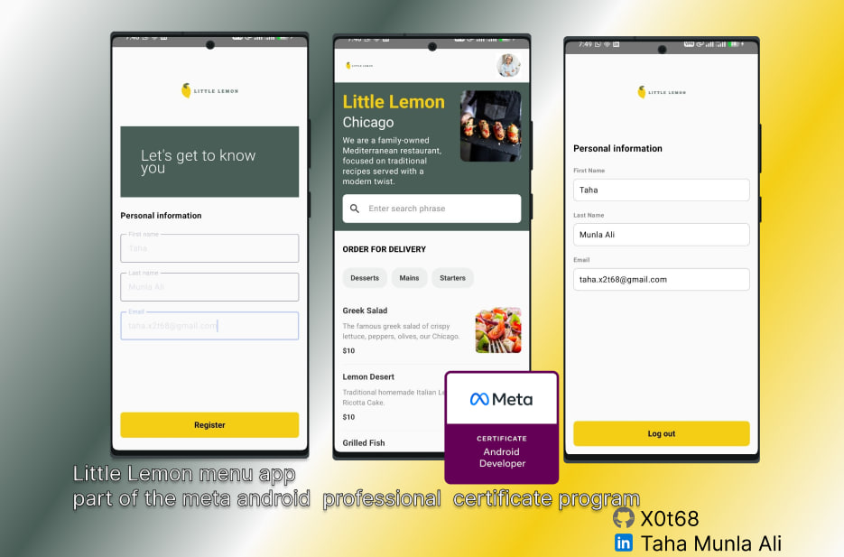

# 🍋 Little Lemon Android App

<p align="center">
  
</p>

<p align="center">
  <strong>A modern, sleek Mediterranean restaurant application built for Android.</strong>
</p>

---

## 📝 Overview
**Little Lemon** demonstrates a complete and robust Android development lifecycle. The app delivers a seamless user experience, featuring a custom onboarding flow, remote data fetching, offline-first local persistence, and a highly dynamic user interface built using the latest industry standards.

Developed as a capstone project for the **Meta Android Developer Professional Certificate**.

---

## 📸 UI Preview & Experience
Our interface focuses on clean design and fluid user interactions:
*   **Onboarding:** A simple, clean, and welcoming registration flow.
*   **Home Screen:** An interactive, rich menu equipped with instantaneous search and quick filters.
*   **Profile:** A minimalist, clean layout for managing user sessions and details.

---

## 🚀 Key Features

*   **👤 Seamless User Onboarding:** A custom registration flow that securely collects user details (First Name, Last Name, Email) and persists login states locally using **SharedPreferences**.
*   **🌐 Dynamic Menu Integration:** Real-time fetching of structured restaurant menus from a remote API endpoint.
*   **💾 Offline-First Architecture:** Full implementation of **Room Database** to cache menu items locally, ensuring uninterrupted app functionality even without an active internet connection.
*   **🔍 Smart Search & Categorization:**
    *   *Real-time Search:* Instantly filter dishes by name or description as you type.
    *   *Quick Filters:* Smooth, horizontal scrollable category tabs (Starters, Mains, Desserts, Drinks).
*   **🎨 Modern UI/UX:** Built entirely using **Jetpack Compose** following Material 3 guidelines, featuring responsive layouts and custom restaurant branding colors.

---

## 🛠 Tech Stack

| Component | Technology | Description |
| :--- | :--- | :--- |
| **UI Framework** | Jetpack Compose | Declarative UI structure with smooth state management |
| **Networking** | Ktor Client | High-performance asynchronous HTTP client |
| **Local Database** | Room | SQLite abstraction layer for robust caching |
| **Serialization** | Kotlinx Serialization | Type-safe JSON parsing and data mapping |
| **Image Loading** | Glide (Compose Support) | Asynchronous image loading and caching |
| **Navigation** | Jetpack Compose Navigation | Type-safe declarative app routing |
| **Build System** | Gradle Version Catalog | Centralized dependency management (`libs.versions.toml`) |

---

## 📖 Project Architecture

The codebase follows the **Repository Pattern** and a clean separation of concerns:

*   `MainActivity.kt` — The main entry point that initializes the local database, configures the Ktor client, and coordinates top-level application states.
*   `MenuRepository.kt` — Acts as the single source of truth; manages data synchronization between the remote API network layer and local storage.
*   `Home.kt` — The core view containing the branded Hero section, real-time search bar, category chips, and the dynamic list of dishes.
*   `NavigationComposable.kt` — Graph controller that handles app routing and conditional landing page logic based on user session status.
*   `Database.kt` / `Network.kt` — Holds structural DAO schemas, entities, and network data transfer objects (DTOs).

---

## ⚙️ Getting Started

### Prerequisites
*   **Android Studio** Iguana (2023.2.1) or newer.
*   **JDK 11** or higher.
*   Basic understanding of **Kotlin** and **Jetpack Compose**.

### Installation Steps

1. **Clone the repository:**
   ```bash
   git clone [https://github.com/x0t68/Little-lemon.git](https://github.com/x0t68/Little-lemon.git)
